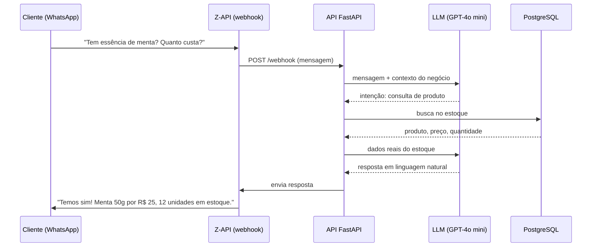
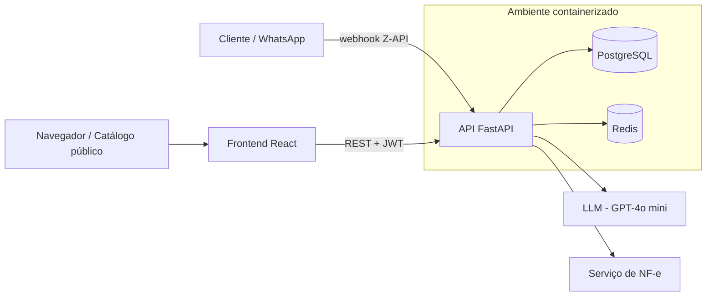

# Helo — Plataforma SaaS Multi-nicho com Atendente de IA

> Plataforma de gestão para pequenos negócios, construída sobre um núcleo modular reaproveitado entre quatro segmentos, com um **atendente de WhatsApp 24/7 movido a LLM** conectado aos dados reais do negócio.


> **Repositório vitrine.** Aqui estão documentadas a arquitetura, as decisões técnicas e as funcionalidades do projeto. O código de produção fica em repositório privado porque contém integrações e dados de clientes reais.

---

## O problema

Pequenos negócios de bairro (oficinas, tabacarias, consultórios, restaurantes) controlam estoque, vendas e atendimento no papel ou em planilhas. O dono responde WhatsApp o dia inteiro, perde vendas fora do horário e não sabe o que tem em estoque.

O Helo resolve isso com uma plataforma de gestão simples e com um atendente de IA que responde clientes sozinho, consultando o estoque em tempo real.

---

## Destaque: atendente de WhatsApp com IA

O diferencial do produto é um agente de atendimento que funciona 24 horas por dia:



- O LLM **interpreta a intenção** do cliente; quem fornece os fatos é o backend, consultando o banco, para reduzir alucinação de preço e estoque.
- A mesma lógica atende todos os nichos, mudando apenas o contexto do negócio injetado no prompt.

---

## Nichos

| Sistema | Foco |
|---------|------|
| **Helo Oficina** | Ordens de serviço, orçamentos, histórico de manutenção por veículo |
| **Helo Tabacaria** | Catálogo público, controle de validade, fidelidade, múltiplas unidades |
| **Helo Odonto** | Agendamento, prontuário, lembretes |
| **Helo Restaurante** | Gestão de restaurante sobre o mesmo núcleo (em desenvolvimento) |

---

## Funcionalidades

- **Autenticação e permissões:** JWT com controle de acesso por papel (RBAC) e rate limiting com Redis.
- **Dashboard** com visão consolidada da operação e suporte a múltiplas unidades.
- **Estoque:** cadastro, movimentações e controle de validade.
- **Ordens de serviço e orçamentos**, com conversão de orçamento em OS.
- **Fluxo de caixa** e **programa de fidelidade**.
- **Emissão de NF-e** integrada.
- **Catálogo digital público**, sem login, sincronizado com o estoque e com pedido direto pelo WhatsApp.
- **Atendente de IA no WhatsApp** (seção acima).

---

## Arquitetura



**Decisões de projeto**

- **Núcleo compartilhado, nichos como extensões:** autenticação, usuários, multi-unidade e estoque são comuns; cada nicho adiciona seus módulos. Uma nova vertical nasce reaproveitando a base.
- **Um serviço por nicho:** cada sistema roda isolado em Docker (backends nas portas 8000–8003, frontends nas 3000–3003), o que permite evoluir e implantar cada um separadamente.
- **Assíncrono de ponta a ponta:** FastAPI + SQLAlchemy async, adequado a muito I/O (banco, WhatsApp, LLM).
- **Validar antes de construir:** a primeira versão do atendimento foi montada com automação no-code (Z-API + Make.com + Google Apps Script) para testar a ideia com cliente real; só depois virou backend próprio.

---

## Stack

| Camada | Tecnologias |
|--------|-------------|
| Backend | Python, FastAPI, SQLAlchemy (async), Pydantic |
| IA | OpenAI GPT-4o mini, prompt engineering, agente com acesso a dados |
| Banco de dados | PostgreSQL |
| Cache / Rate limiting | Redis |
| Autenticação | JWT, RBAC |
| Frontend | React, JavaScript |
| Integrações | Z-API (WhatsApp), NF-e |
| Infra | Docker, Docker Compose |
| Desenvolvimento | Claude Code (desenvolvimento assistido por agentes) |

---

## Estrutura (código privado)

```
helo/
├── backend/
│   └── app/
│       ├── models/      # modelos SQLAlchemy
│       ├── schemas/     # validação Pydantic
│       ├── routers/     # endpoints da API
│       ├── services/    # regras de negócio, WhatsApp, IA, NF-e
│       └── core/        # config, segurança (JWT, RBAC), dependências
├── frontend/
│   └── src/
│       ├── pages/       # Dashboard, Estoque, Orçamentos, Catálogo...
│       └── components/
├── docker-compose.yml
└── .env.example
```

---

## Roadmap

- [ ] Testes automatizados (pytest)
- [ ] Deploy em produção com CI/CD
- [ ] Memória de conversa e histórico por cliente no atendente de IA
- [ ] Relatórios e exportação de dados
- [ ] QR Code do catálogo para impressão na loja

---

## Autor

**Cristopher Ferreira de Freitas** — estudante de Análise e Desenvolvimento de Sistemas (IBMR), em transição da química industrial para tecnologia, com foco em desenvolvimento de software com IA aplicada.

- E-mail: cristopher.cfreitas@gmail.com
